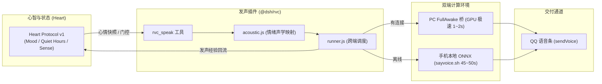

# @dsh/rvc: RVC 拟人音色与 Heart 情绪自适应发音插件

> **当前版本**: `0.1.2`  
> **所属架构**: DSHA Sovereign Plugin Ecosystem  
> **服务对象**: 小满（Dv5 大肥鱼少女音色）  
> **协议绑定**: Heart Protocol v1 (Microkernel State & Activity Gate)

---

## 1. 核心定位与设计思想

本插件为 DSH 宿主层提供拟人发声能力。底层利用红米手机端已部署的 1GB ONNX 声学模型（`model.onnx`、`hubert.onnx`、`rmvpe.onnx`、`Dv5.mobile.index`）与离线推理脚本，通过微内核协议将**情绪心境（Mood）**动态映射为**声学特征（Pitch / Brightness / Rate）**，并支持 **PC GPU 极速算力分流与手机离线纯本地推理** 双模式。

### 架构协同关系



---

## 2. 声学与心境映射矩阵

基于小满 Dv5 大肥鱼音色实测基准（基频 `P0: ~255.7Hz`, `P4: ~210.1Hz`）：

| 心境状态 (Mood) | 唤醒度 (Arousal) | 音高 (Pitch) | 7kHz 补偿 (Brightness) | Edge-TTS 语速 | 听感特征 |
|---|:---:|:---:|:---:|:---:|---|
| **元气活泼态** (Joy / Excited) | `arousal >= 0.5` | **`0`** (P0, 255.7Hz) | `2.8 dB` | `+6%` | 清脆高频少女音，开心/兴奋/分享好物 |
| **沉稳日常态** (Calm / Focused) | `0.35 <= arousal < 0.5` | **`-4`** (P4, 210.1Hz) | `2.5 dB` | `+0%` | 温柔日常音，叙事、聊天、安安静静 |
| **疲惫慵懒态** (Tired / Sleepy) | `energy < 0.4` | **`-4`** (P4, 210.1Hz) | `2.0 dB` (低通柔化) | `-8%` | 慵懒低沉，消除刺耳高频，睡前耳语 |

> [!CAUTION]
> **严禁使用 `pitch = -2`**：该参数已被实测证实会导致严重八度跳变颤音破音（F0 标准差恶化至 97.2Hz）。插件内部内置自动拦截校验，误传时自动校正为 `-4`。

---

## 3. 注册工具与参数 Schema 规范

> [!NOTE]
> **v0.1.2 关键加固**：适配 `@deepseek-ai/dsh-tools` 参数编译契约，`parameters` 必须是**直接平铺的属性字典**（例如 `{ text: { type: 'string', required: true, description: ... } }`），严禁包含外层 `{ type: 'object', properties: { ... } }`，杜绝 `JsonSchemaError: parameters.type must be a value schema object`。

### `rvc_speak`
- **参数**:
  - `text` (string, 必须): 小满要说的话。
  - `pitch` (number, 可选): 显式音高覆盖 (仅限 0 或 -4)。
  - `emotion` (string, 可选): 显式情绪覆盖 (如 'joy', 'calm', 'sleepy')。
  - `send_to_qq` (boolean, 可选, 默认 true): 是否直接通过 QQ 发送原生语音条。
- **保护特性**:
  - 发声前调用 `heart.evaluateActivity`，若在深夜静音期（Quiet Hours）或沉睡态，自动拦截保护，降级为纯文本回复，避免发烫与惊扰。
  - 发声完成后自动调用 `heart.observe` 将发声经验记入心智感知日志。

### `rvc_sing`
- **参数**:
  - `input_audio` (string, 必须): 原歌曲音频路径。
  - `task_name` (string, 必须): 任务名。
  - `pitch` (number, 可选): 变调半音数。
- 启动全流程唱歌链（UVR MDX-Net 分离人声 -> RVC 音色转换 -> 伴奏重采样与限幅混音）。

---

## 4. 自动化测试

```bash
node --test test/*.js
```
所有 8 项声学映射、-2 拦截防线、静音期保护与 Heart 联动单测持续 100% 通过。
